  

<strong>I write code. Sometimes it even works.</strong>

  Full-Stack Developer · Mobile App Developer · Noida, India

  
  
  

---

  

## About me

I build software that feels **alive, intentional and human-centered**, with a focus on clarity, speed and good design. I ship Flutter and React Native apps to Google Play, and SaaS platforms with Next.js and PostgreSQL.

> *Make it simple. Make it elegant. Make it unforgettable.*

- 💼 Full-Stack Developer at **Futurebits** (remote)
- 🎓 B.Tech in Information Technology, Noida Institute of Engineering & Technology
- 🚀 Open to **full-time roles and freelance work**
- 🤖 My [portfolio](https://happy-fox.staticdomains.app/) has an AI assistant named **Ron**. Ask him about my work, any time.
- 📫 Reach me at **prabork@gmail.com**

  

## What I work on

| | |
| :--- | :--- |
| ⚡ **Real-time systems** | WebSockets, Socket.IO, event-driven flows |
| 🎨 **Modern frontend** | React, Next.js, Tailwind, component architecture |
| 📱 **Mobile apps** | Flutter and React Native, smooth transitions, app UX |
| ⚙️ **Backend** | Node, Express, JWT, REST APIs, PostgreSQL, MongoDB |
| 📊 **Dashboards & AI** | Analytics, AI insights, clean data experiences |

## Tech stack

  

## Featured work

| Project | What it is | Links |
| :--- | :--- | :--- |
| **Theoretic Hotels** | Multi-tenant hospitality SaaS: reservations, inventory, restaurant POS, invoicing, Razorpay payments. Next.js, TypeScript, PostgreSQL, Prisma, Redis. | [Live site](http://theoretichotels.com/) |
| **Nella** | Beauty treatment tracker with skincare routines, reminders and spend insights. Flutter. | [Google Play](https://play.google.com/store/apps/details?id=com.mynella.nella) · [App Store](https://apps.apple.com/in/app/nella-beauty-intelligence/id6781161758) |
| **mivadodara** | Teacher attendance app with OTP login and fingerprint check-in, synced to an admin dashboard. | [Google Play](https://play.google.com/store/apps/details?id=org.mivadodara.app) |
| **Blame Game** | Offline party card game with 25+ question packs and in-app purchases. | [Google Play](https://play.google.com/store/apps/details?id=com.prabor.blamegame) |
| **Portfolio** | This notebook-style site, built with React, TypeScript, Tailwind and Framer Motion. | [Live site](https://happy-fox.staticdomains.app/) · [Source](https://github.com/Praborkar/webportfolio) |

More on my [repositories page](https://github.com/Praborkar?tab=repositories&type=source).

## Hackathons & innovation

- 🧠 [Adobe Round 1B: Persona-Driven Document Intelligence](https://github.com/Praborkar/Round-1B-Persona-Driven-Document-Intelligence)
- 📄 [Adobe Round 1A: Understand Your Document](https://github.com/Praborkar/Round-1A-Understand-Your-Document)
- 🏆 [Smart India Hackathon](https://github.com/Praborkar/SIH)

## GitHub stats

  
  
  

---

  <em>Clean engineering. Real-time experiences. Building things that just feel right.</em>

